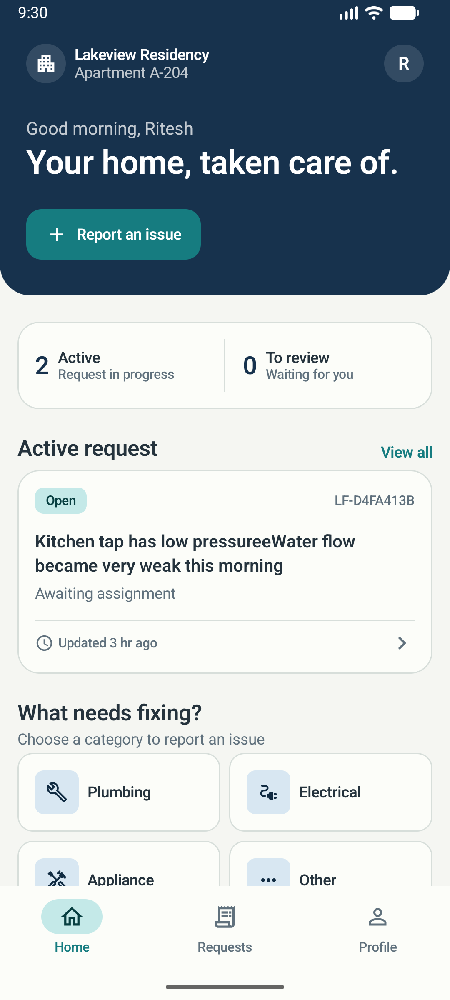
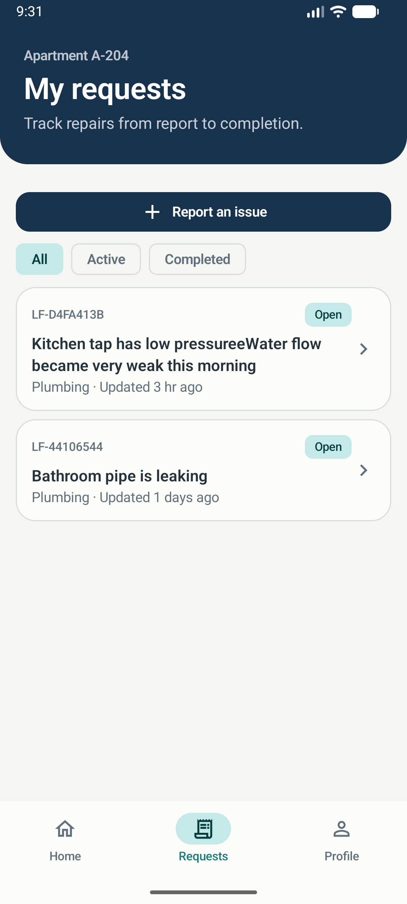
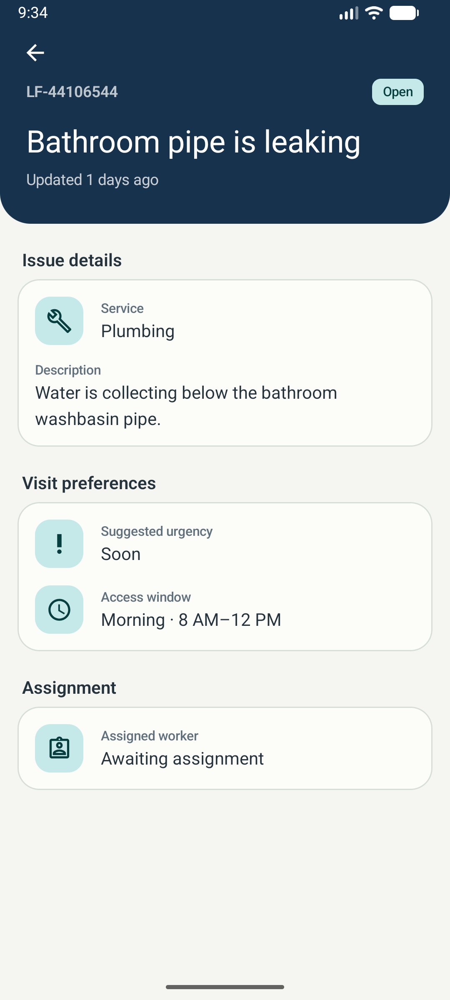
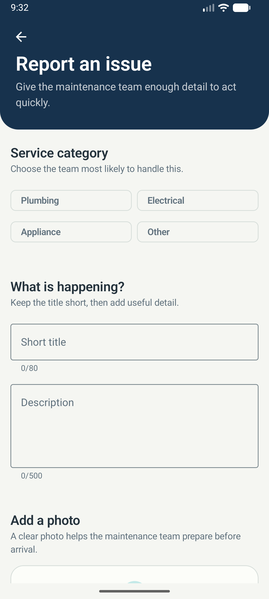
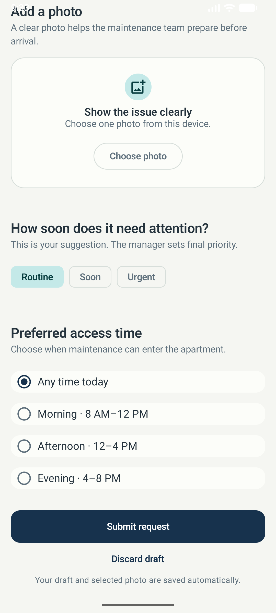
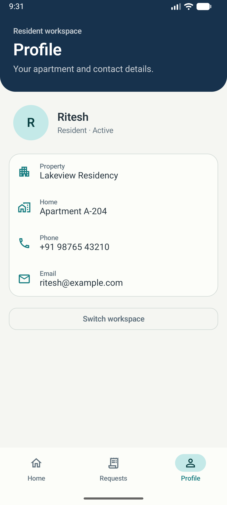
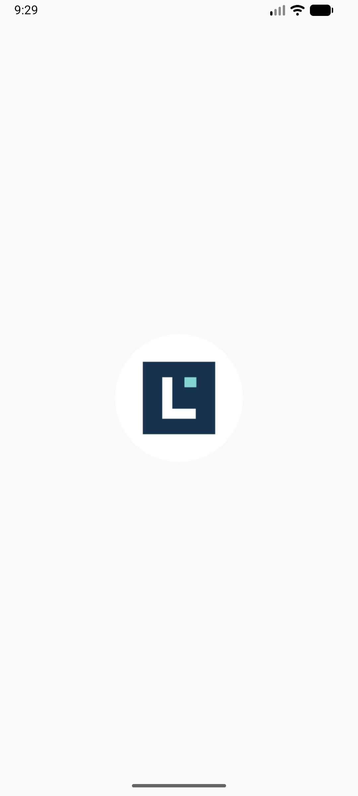

# LocalFix

LocalFix is an Android app for reporting and tracking maintenance problems in apartment buildings. It comes from a real problem I faced, and I could not find a simple local app built around this exact workflow.

I started this project because of a problem I have seen in my own apartment. Most maintenance complaints are shared through phone calls, chat messages, or in-person conversations. It becomes difficult to know who is handling an issue, whether any progress has been made, or if the complaint was forgotten completely.

My first goal is to use LocalFix in my apartment and improve it from feedback by actual residents and maintenance workers. For now, I am keeping it as a personal Android project rather than publishing it in an app store.

> **Current status:** The Android resident → manager → worker flow works against the FastAPI backend. This repository also contains a free-tier deployment setup; the hosted service has not been created yet.

## Resident experience

<table>
  <tr>
    <td align="center"><br><strong>Resident home</strong></td>
    <td align="center"><br><strong>Request tracking</strong></td>
    <td align="center"><br><strong>Request details</strong></td>
  </tr>
  <tr>
    <td align="center"><br><strong>Issue details</strong></td>
    <td align="center"><br><strong>Visit preferences</strong></td>
    <td align="center"><br><strong>Resident profile</strong></td>
  </tr>
  <tr>
    <td colspan="3" align="center"><br><strong>Launch experience</strong></td>
  </tr>
</table>

## What the app does

- Residents sign in, join their apartment using a manager's invite code, report an issue with an optional photo, and follow it through completion. Unfinished forms and failed submissions stay on the device until they can be sent.
- Managers see the property's requests, invite residents and workers, set priorities, and assign work.
- Workers see their assigned jobs, start a repair, and submit a completion note, parts used, and a photo. Residents can then confirm the repair or ask for more work, with a rating and feedback.
- The backend checks who can access each property and keeps ticket history in PostgreSQL. Repeated requests and retries do not create duplicate tickets.
- Android can show a local notification when refreshing the app reveals a new assignment or changed request. It does not send instant background notifications.

Issue and worker completion photos are stored privately by the backend and are shown only to the people allowed to view the ticket.

## Architecture

```text
Jetpack Compose UI
        │
ViewModel + StateFlow
        │
Repositories ──────────── Room (drafts and pending actions)
        │
      JSON API
        │
FastAPI → Service layer → SQLAlchemy → SQLite locally / Neon PostgreSQL when hosted
                                          └────→ private ticket photos
```

I built it one complete flow at a time, from the Android screen through the API to the database.

## Tech stack

| Area | Technologies |
| --- | --- |
| Android | Kotlin, Jetpack Compose, Material 3, Navigation Compose, Coroutines, StateFlow |
| Local data | Room, schema migrations, Android Photo Picker, Coil |
| Backend | Python, FastAPI, Pydantic, Uvicorn |
| Persistence | SQLAlchemy, Alembic, SQLite locally, Neon PostgreSQL for the personal hosted setup |
| Cloud | Render free web service, Docker, Firebase Authentication |
| Testing | JUnit, Compose UI tests, Room migration tests, FastAPI TestClient, Ruff, Android Lint |

## Run locally

### Backend

Python 3 and a virtual environment are required.

```shell
cd backend
python3 -m venv .venv
.venv/bin/python -m pip install -r requirements-dev.txt
.venv/bin/alembic upgrade head
.venv/bin/uvicorn app.main:app --reload
```

The API runs at `http://127.0.0.1:8000`; interactive API documentation is available at `http://127.0.0.1:8000/docs`.

### Android

1. Open the `android` directory in Android Studio.
2. Start an Android emulator running API 26 or newer.
3. Run the `app` configuration.

The debug build is already configured to reach the backend from the Android emulator at `http://10.0.2.2:8000`.

## Run it online for personal use

1. Create a **free Neon PostgreSQL** project and copy its direct connection string. Keep it private.
2. In Firebase Authentication, create or sign in to the first manager account and copy that user's **UID** from the Firebase console.
3. Connect this repository to Render and create a Blueprint from `render.yaml`. Its free web service will ask for `DATABASE_URL`, the Firebase service-account JSON, the manager UID, your property name, and comma-separated apartment labels. Enter these in Render's environment settings, never in Git.
4. After Render reports healthy, build Android with its real HTTPS URL: `./gradlew :app:assembleDebug -PlocalfixApiBaseUrl=https://YOUR-SERVICE.onrender.com`. Install that APK on your Android device. Without this option, the debug build still points to the local emulator backend.
5. Sign in as manager, create resident and worker invites, then use those codes to join the other accounts.

The free Render web service sleeps when idle, so the first request can take about a minute. Neon has a free usage allowance, but photos share its database storage. Back up data you care about. This setup is for a personal project, not a production service with uptime guarantees.

LocalFix is for the maintenance team already working in an apartment, not a marketplace for outside service providers. The manager web dashboard and app-store release are outside this personal-project scope.
